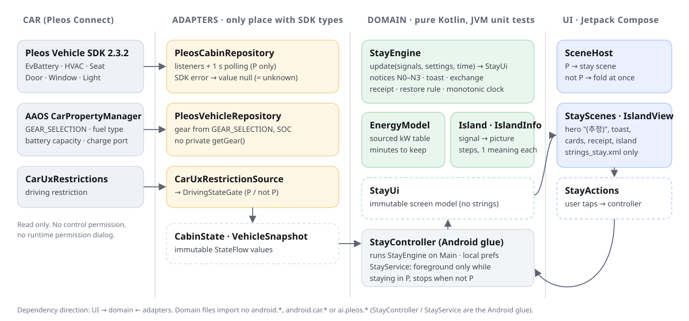
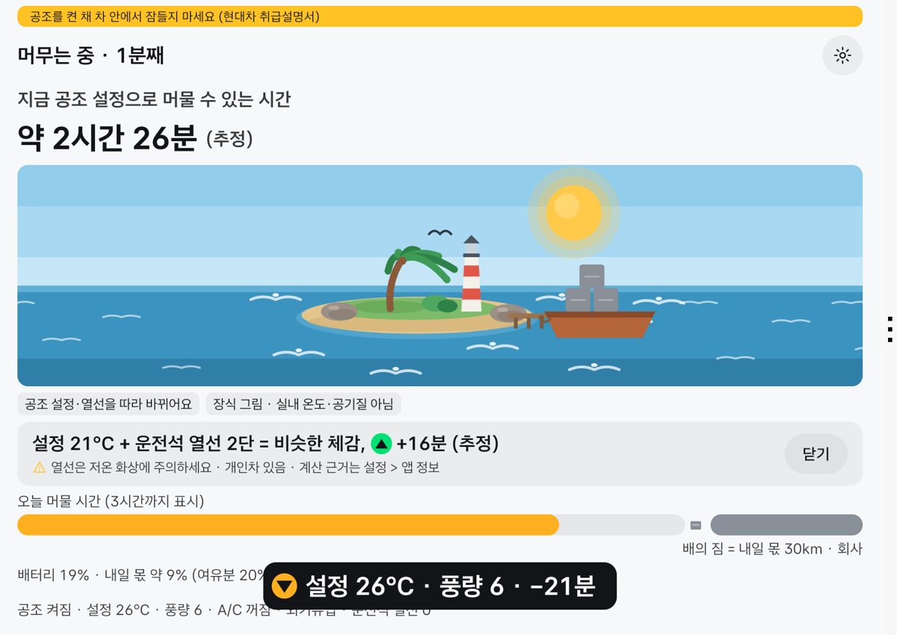
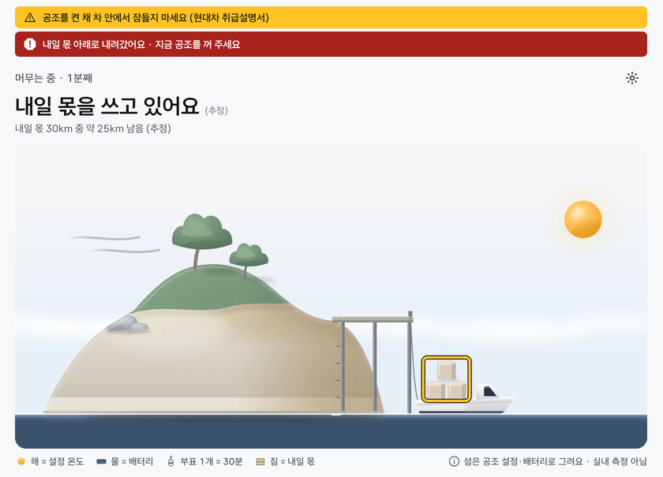
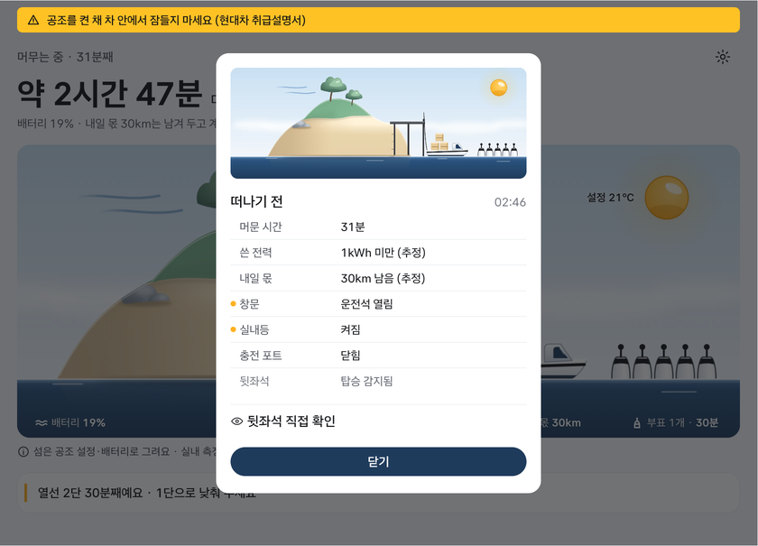

# 차섬 — 오늘 머물 시간을 보여 주는 작은 섬

전기차를 세워 두고 공조를 켠 채 차 안에 머물 때, **지금 설정으로 얼마나 더 머물 수 있는지(추정)**를 내일 탈 거리만큼 배터리를 남긴 기준으로 보여 줍니다. 다이얼을 돌리면 시간 변화가 바로 보이고, 화면 속 작은 섬의 날씨가 바뀝니다. 떠날 때는 창문·실내등·충전구·뒷좌석 확인 영수증을 보여 줍니다.

Pleos Connect(Android Automotive OS)용이며, Pleos Playground **Vehicle SDK**로 공조·좌석·문·창문·조명 신호를 읽습니다.

  -blue)  

### 구조


- **어댑터**(`cabin/`, `vehicle/`)만 Pleos·AAOS SDK 타입을 압니다. SDK 오류는 값 `null`(= 모름)로 바꿔 넘깁니다.
- **도메인**(`stay/` StayEngine·EnergyModel·Island·IslandInfo)은 Android 없는 순수 Kotlin이라, 안전 규칙과 숫자를 모두 JVM 단위 테스트로 검사합니다.
- **화면**(`ui/`)은 불변 모델 `StayUi`만 그리고, 문구는 `strings_stay.xml`에만 있습니다. 포그라운드 서비스는 P에서 머무는 동안만 켜집니다.

| 히터를 올리면 해가 커지고 남은 시간이 줄어듦 (비슷한 체감 카드) | 내일 몫 아래로 내려가면 경고 | 운전석 문을 열면 떠나기 전 영수증 |
|---|---|---|
|  |  |  |

## 검증 표
제출 APK(`apk/Chaseom_Chaseom_release.apk`, sha256 `93a5cc4fbe11713d4371193fe1972bc108fbce5c85b5779ec0ca38cdf75b5cde`)를 Pleos Connect Emulator 2.1.0에서 잰 값입니다. 원자료는 [docs/evidence/measure_release.json](docs/evidence/measure_release.json)이고, 다시 재려면 `python tools/measure.py apk/Chaseom_Chaseom_release.apk out.json`을 실행합니다. 이 표의 해시가 지금 APK와 같은지는 `python tools/check_hash.py`로 확인합니다.

| 항목 | 값 |
|---|---|
| 단위 테스트 | **120개 통과** (`./gradlew testDebugUnitTest`, 에뮬레이터 없이 1분) |
| 테스트 커버리지 (Kover, 라인) | 도메인 **98.2%** (`stay/`의 엔진·계수·섬, Android 접착층 제외) · 전체 27.0% (화면·SDK 어댑터는 에뮬레이터 시나리오로 검증). `./gradlew koverXmlReportDebug`, 원자료 [docs/evidence/coverage.xml](docs/evidence/coverage.xml) |
| 다이얼 → 토스트가 화면에 뜨기까지 (10회) | 중앙값 **28 ms**, 최대 34 ms |
| 기어 P → D, 섬과 숫자가 사라지기까지 (10회) | 최대 **26 ms** (중앙값 11 ms) |
| 다이얼 → 섬 그림이 바뀌기까지 (10회) | 중앙값 **30 ms**, 최대 39 ms |
| 앱 시작 (`am start -W`, 콜드 스타트) | 1.5초 이내 (이번 측정 0.92–0.95초, 에뮬레이터 상태에 따라 0.8–1.5초) |
| 정지 화면 CPU (30초) | 평균 **0.0%** |
| 10초마다 다이얼 1회, 60초 평균 CPU | 평균 2.2% (전환 순간 최대 27%) |
| 메모리 (PSS) | 54 MB |
| 런타임 권한 팝업 | **0** (요청하는 권한은 모두 normal) |
| 차량 제어 | **0** (앱은 차를 읽기만 하고, 공조를 끄거나 바꾸지 않음) |

- CPU는 코어 1개 기준 %입니다(에뮬레이터는 4코어).
- 시간은 Virtual Console에 값을 쓴 시각부터, 앱이 남긴 로그 시각까지입니다. 토스트는 화면에 그린 첫 프레임까지, P→D는 섬이 화면 구성에서 빠지는 시각까지입니다. 호스트와 에뮬레이터 시계 차를 보정하므로 약 ±20 ms 오차가 있습니다.

## 30초 체험
1. Pleos Connect Emulator를 켜고 APK를 설치합니다: `adb install -r apk/Chaseom_Chaseom_release.apk`
2. 손으로 해 보기: Virtual Console에서 **배터리를 19%**로, 기어를 **P**로 둡니다. 그다음 운전석 설정온도를 22°C에서 26°C로, 풍량을 3에서 6으로 올려 보세요(토스트 약 −21분). 비슷한 체감 카드가 뜨면 설정 21°C + 운전석 열선 2단으로 바꿔 보세요(약 +16분). 배터리가 약 20% 이상이면 남은 시간이 "3시간 이상"으로 표시돼 숫자 변화가 보이지 않습니다.
3. 또는 자동으로: `python tools/demo.py`
   - Virtual Console 조작을 자동으로 재생합니다. 앱은 그 값을 실제 차량 신호 경로(Vehicle SDK·AAOS)로 받습니다. 앱 안에 데모 모드나 가짜 값은 없습니다.
   - 단계마다 화면 문구와 반영 시간(ms)을 출력하고, 끝에 `6/6 장면 확인`을 냅니다. 영수증 단계에서 1분쯤 기다립니다.
   - `demo.py`는 앱 설정을 그대로 둡니다. QA 시나리오 도구 `python tools/scenario.py <폴더>`는 `pm clear`로 **앱 설정(내일 거리·장소 이름)을 초기화**한 뒤 처음 실행 화면부터 돕니다.
   - 자세한 내용은 [tools/README.md](tools/README.md)에 있습니다.

## 안전 규칙 = 테스트
아래 규칙을 어기는 코드나 문구를 넣으면 테스트가 실패합니다(CI 설정: [docs/ci/ci.yml](docs/ci/ci.yml)). 문구 테스트는 화면 문자열 파일을 직접 읽어 검사합니다.

| 지키는 규칙 | 실패하는 테스트 |
|---|---|
| 뒷좌석을 "비었음"이나 초록으로 표시하지 않고, 영수증에는 늘 "뒷좌석 직접 확인" 줄이 있다 | `WordingRulesTest.rearSeatWording`, `StayEngineTest.rearRowNeverHasADotForAnyOccupancy`, `StayEngineTest.receiptRowsOrderAndRearAlwaysCheck` |
| 남은 시간은 3시간 위로 늘지 않고, 토스트·환율 카드도 3시간으로 자른 값끼리 비교한다 | `StayEngineTest.toastDeltaUsesThreeHourCappedValues`, `StayEngineTest.toastDeltaCrossingTheCapIsBounded`, `StayEngineTest.noExchangeCardWhenAboveCap` |
| 계산된 숫자에는 늘 "(추정)"이 붙는다 | `WordingRulesTest.computedValuesMarkedEstimate` |
| 수면·차박·보장·"최초" 같은 금칙어가 없다 (취급설명서 경고 인용만 예외) | `WordingRulesTest.noBannedWordsOutsideTheWarnings`, `WordingRulesTest.designRuleWordsAbsent`, `WordingRulesTest.manualQuoteVerbatimWithSource` |
| 주행 중 화면은 숫자 없이 짧은 안내뿐이다 | `WordingRulesTest.drivingGlanceShortAndNumberFree` |
| 앱은 공조를 끄지 않는다고 말하고, 내일 몫은 "잠금"이 아니다 | `WordingRulesTest.keepShareNeverLockedAndAppDoesNotControlClimate` |
| 머무는 동안 60분마다, 야간에는 시작과 매시 고지가 다시 뜬다 | `StayEngineTest.hourNoticeEvery60Minutes`, `StayEngineTest.nightNoticeAtStartAndHourly`, `StayEngineTest.nightBeginningDuringStayShowsNightCard` |
| 고지가 떠 있으면 섬은 멈추고 고지가 맨 위다 | `IslandTest.frozenUnderNoticeOrReceipt` |
| 섬은 2열 탑승·창문·문에 반응하지 않는다 (그림이 "아무도 없다"를 말하지 않게) | `IslandTest.rearSeatWindowsAndDoorsAreNotInputs` |
| 섬은 늘 낮이고 장식이라고 말한다 (모닥불·밤·별 금지) | `WordingRulesTest.islandWordingDaytimeAndDecoration` |
| 범례·해 옆 숫자·구름 문구는 확정 문구 그대로이고 "설정"을 빼지 않는다. 공기 상태를 판정하는 말이 없다 | `WordingRulesTest.roundOneIslandSaysNothingAboutSeatHeat` |
| 구름은 내기순환 20분(창문 닫힘) 뒤에만, 하나로 고정, 외기·창문 열림에 조용히 사라짐 | `StayEngineTest.recircCloudAfter20MinIgnoresSnoozeAndLeavesQuietly`, `StayEngineTest.recircCloudNeedsClimateOnAndKnownClosedWindows`, `IslandInfoTest.weatherFollowsClimateAndOffIsTheSmallSun` |
| 내일 배(= 내일 몫)는 배터리가 줄어도 기울거나 가라앉지 않는다. 바뀌는 것은 짐 상자 윤곽선과 문구뿐 | `IslandTest.belowKeepEmptiesTheDayBandButNeverChangesTheBoatOrSun`, `IslandTest.crateOutlineOnlyNearOrBelowKeep` |
| 배의 정박(1.6초)은 차가 다녀왔을 때만 한 번, 출발할 때는 아무것도 움직이지 않고 접힌다 | `IslandTest.mooringOnlyWhenTheCarCameBack`, `IslandTest.mooringWindowAndCoverRules` |
| 정차 중 공조를 놀이처럼 조작하게 하는 명령형 문구가 없다 | `WordingRulesTest.noImperativeDialPrompt` |
| 전기차로 확인되지 않으면 남은 시간·토스트·환율 카드를 모두 숨기고 "시동" 고지를 한다 | `ModeAndEnergyTest.modeRules`, `StayEngineTest.reducedModeHasNoEnergyAnywhere`, `WordingRulesTest.reducedModeIdlingNotice` |
| 기어 P를 벗어나면 체류가 끝나고 모든 카드가 닫힌다 | `StayEngineTest.leavingParkEndsStayAndClosesEverything` |

에뮬레이터로 화면에서 볼 수 없는 안전 기능 4개(1시간 재경고, 야간 고지, 내연·하이브리드용 축소 모드, 등받이 고지)는 위 테스트로 검증합니다. 출시 빌드에는 시간을 빠르게 돌리는 코드가 없습니다.

## 신호를 못 읽을 때 (모르면 안전한 쪽으로)
| 신호 | 못 읽을 때 차섬이 하는 일 | 이유 | 테스트 |
|---|---|---|---|
| 기어 (앱 시작 직후, 아직 한 번도 못 읽음) | "차와 연결하는 중이에요"만 표시 (숫자·버튼 없음) | 주행 중 화면으로 오해하지 않게 | 화면 확인 `tools/edges.py` (E4-5) |
| 기어 (읽은 뒤 끊김·모름) | 주행 중으로 보고 화면을 접음 | 주행 중에 숫자·버튼을 보이지 않기 위해 | `DrivingStateGateTest.unknownGearFailsSafeToDriving` |
| 차량 연결 | 마지막 값이 P였어도 주행 중으로 봄 | 끊긴 동안 차가 움직였을 수 있음 | `DrivingStateGateTest.disconnectedFailsSafeToDrivingEvenIfLastGearWasPark` |
| 시스템 주행 제한 | P여도 화면을 접음 | 시스템 판단이 앱보다 우선 | `DrivingStateGateTest.systemUxRestrictionOverridesParkGear` |
| 연료 종류 | 축소 모드 (남은 시간 없음, "시동" 고지) | 내연차에 공조를 계속 켜도 된다는 신호를 주지 않기 위해 | `StayEngineTest.fuelReadFailureStartsReduced`, `ModeAndEnergyTest.modeRules` |
| 배터리 % 또는 용량 | 축소 모드 | 숫자를 지어내지 않음 | `ModeAndEnergyTest.modeRules` |
| 전비 | 기본값 5 km/kWh (차가 준 값이 더 작으면 그 값) | 내일 몫을 크게 잡는 쪽 | `ModeAndEnergyTest.efficiencyUsesTheSmallerOfVehicleAndDefault` |
| 등받이 각도 | 등받이 고지를 끔 (시간 고지·야간 고지는 그대로) | 값이 안 움직이면 판단하지 않음 | `StayEngineTest.noBackrestCapabilityMeansNoN3` |
| 2열 탑승 | 영수증에 늘 "뒷좌석 직접 확인", 감지 안 되면 회색 "감지 안 됨 — 직접 확인하세요" | 감지 실패가 "비었음"으로 읽히지 않게 | `StayEngineTest.rearRowNeverHasADotForAnyOccupancy` |
| 실내등 · 충전 포트 | 영수증에서 빼지 않고 "확인 안 됨" | 모르는 것을 "꺼짐"으로 말하지 않음 | `StayEngineTest.lightUnknownIsReportedNotDropped` |
| 창문 | 영수증에 "확인 안 됨" (어느 창이든 값이 없으면 "닫힘"이라고 하지 않음). 공기 카드도 "모두 닫힘"으로 치지 않음 | 모르는 것을 "닫힘"으로 말하지 않음 | `StayEngineTest.windowsUnknownIsReportedNotClosed`, `StayEngineTest.unknownWindowDoesNotCountAsClosed` |
| 앱이 꺼진 사이의 시간·배터리 | 10분 넘게 지났거나, 충전됐거나, 배터리가 5%p 넘게 다르면 이전 체류를 잇지 않고 새로 시작 | 오래된 체류 시간("1440분째")을 말하지 않음 | `StayEngineTest.restoreStartsNewStayAfter10Min` 외 4개 |
| 체류 중 충전 | 영수증 "충전 중이라 계산하지 않았어요" (0.0kWh라고 하지 않음) | 쓴 전력을 지어내지 않음 | `StayEngineTest.receiptShowsChargingInsteadOfZeroKwh` |
| 와이퍼 · 방향지시등 · 실내등 (섬 입력) | 섬 입력으로 쓰지 않음 | 정차 중 놀이 조작을 만들지 않음 | `IslandTest.roundOneLeavesOutWiperGullMoveAndLamp` |

---

## 1. 앱 이름 및 한 줄 소개

- **앱 이름**: 차섬 (Chaseom)
- **한 줄 소개**: 정차 중 차를 만지면 화면 속 작은 섬의 날씨가 바뀌고, 그 위 숫자가 내일 갈 몫을 남긴 채 오늘 머물 시간을 보여 주는 Pleos 차량 앱
- **핵심 기능**
  - **작은 날씨 섬**: 해 크기 = 공조 설정온도, 바람 = 풍량, 물 높이 = 배터리, 부표 = 머문 시간(30분에 1개), 배의 짐 = 내일 몫. 그림 위에는 글자가 없고, 그림 아래 범례 한 줄("해 = 설정 온도 · 물 = 배터리 · 부표 1개 = 30분 · 짐 = 내일 몫")과 캡션 "섬은 공조 설정·배터리로 그려요 · 실내 측정 아님"이 늘 보입니다. 다이얼로 설정온도를 바꾸면 해 옆에 "설정 22 → 26°C"가 2.5초 뜹니다. 기어 P에서만 표시.
  - **맴도는 구름**: 공조를 켠 채 창문을 모두 닫고 내기순환을 20분 넘게 쓰면 섬 위에 구름 하나가 뜨고 범례에 "구름 = 내기순환 N분째 (공기 측정 아님)"가 붙습니다. 시간이 지나도 구름은 늘거나 진해지지 않고, 외기로 바꾸거나 창문을 열면 조용히 사라집니다. 공기질을 재지 않으며, **수동 내기순환 상태만** 읽습니다(자동 내기순환은 읽지 않음).
  - **내일 지킬 몫**: 내일 처음 갈 거리(여유분 20% 포함)를 배터리에서 따로 표시. 남은 시간은 "(추정)", 3시간 넘으면 "3시간 이상".
  - **따뜻함 환율**: 다이얼을 바꾸는 순간 남은 시간 변화(±, 추정)와 비슷한 체감을 더 적은 전력으로 얻는 조합(운전석 열선, 저온 화상 주의) 제안.
  - **안전 고지와 떠나기 전 영수증**: P 진입·1시간·야간에 공조 사용 경고, 운전석 문을 열면 머문 시간·쓴 전력·내일 몫·창문·실내등·충전 포트와 "뒷좌석 직접 확인" 줄. 앱은 공조를 끄지 않음.
- **사용 SDK/API**: `ai.pleos.playground:Vehicle:2.3.2` (EvBattery, HVAC, Seat, Door, Window, Light), AAOS `CarPropertyManager` (연료 종류, 배터리 용량, 충전구, 기어 `GEAR_SELECTION`). 공개 문서에 있는 API만 씁니다.

## 2. 실행 방법

### APK로 바로 실행
1. Pleos Connect Emulator(아래 3번 환경)를 Cold Boot로 실행합니다.
2. 저장소의 APK를 설치합니다.
   ```bash
   adb install -r apk/Chaseom_Chaseom_release.apk
   ```
3. 에뮬레이터 앱 목록에서 **차섬**을 실행합니다. 처음 실행하면 내일 탈 거리 설정 화면이 나옵니다.
4. Virtual Console에서 아래 순서로 조작합니다.
   - 기어 **P**, 공조 전원 켬, 배터리(SOC) 19% → 머무는 화면과 섬
   - 운전석 설정온도·풍량·A/C·내기순환·열선 변경 → 시간 토스트, 섬 날씨 변화
   - 운전석 문 열기 → 떠나기 전 영수증 (문을 닫으면 닫힘)
   - 기어 **D** → 차섬은 섬과 숫자를 바로 접고, 주행 중에는 시스템이 앱 화면을 가립니다

### 소스에서 빌드
Android SDK 위치가 필요합니다. 환경 변수 `ANDROID_HOME`을 설정하거나 `local.properties`에 `sdk.dir=...`을 적습니다(이 파일은 git에서 제외).
```bash
./gradlew assembleDebug        # 디버그 APK: app/build/outputs/apk/debug/ (패키지 app.chaseom.debug)
./gradlew installDebug         # 연결된 에뮬레이터에 설치
./gradlew testDebugUnitTest    # 단위 테스트
```
- 릴리스 APK: `keystore.properties`(예시 `keystore.properties.example`)를 준비한 뒤 Windows PowerShell에서 `scripts/build-release.ps1`을 실행하면 `apk/Chaseom_Chaseom_release.apk`가 생깁니다.
- Windows에서 프로젝트 경로에 한글이 있으면 AGP가 빌드를 거부합니다. 영문 경로에 클론하거나 스크립트(자동 `subst`)를 쓰세요.
- 디버그 빌드는 Pleos 차량 서비스가 없는 환경에서 테스트용 가짜 데이터로 동작합니다. 릴리스 빌드는 항상 실제 Pleos SDK만 씁니다.

## 3. 테스트 환경 및 설정

| 항목 | 값 |
|---|---|
| 에뮬레이터 | Pleos Connect Emulator **v2.1.0** (System image `system-images;android-34;pleos_car_emulator;x86_64`), 2560×1440 |
| AVD | Automotive 폼팩터, API 34, RAM 4GB, **Cold Boot** |
| 시스템 이미지 사이트 (Windows) | `https://nexus-playground.pleos.ai/repository/raw-releases/connect-avd/2.x/crp-sys-img.xml` |
| 빌드 | Android Studio (JBR), Gradle 9.9.0, AGP 9.5.1, Kotlin 2.4.21, compileSdk 37 |
| 앱 SDK 수준 | minSdk 28, targetSdk 34 |
| 패키지 | `app.chaseom` (디버그 `app.chaseom.debug`) |
| UI | Jetpack Compose, Pleos 디자인 토큰, 대형 터치 타깃 |
| 권한 (런타임 권한 요청 0, 차량 제어 권한 0) | Pleos `CAR_ENERGY`, `CAR_CLIMATE`, `CAR_SEATS`, `CAR_WINDOWS`, `CAR_DOORS`, `CAR_LIGHTS` / AAOS `CAR_INFO`, `CAR_ENERGY_PORTS`, `CAR_POWERTRAIN` / `FOREGROUND_SERVICE`, `FOREGROUND_SERVICE_SPECIAL_USE` |
| 테스트 시나리오 | Virtual Console: 기어 P↔D, 배터리 잔량, 공조(설정온도·풍량·A/C·내기순환), 운전석·조수석 열선, 문, 창문, 실내등, 2열 탑승 |

에뮬레이터 참고: Virtual Console의 등받이 각도는 에뮬레이터 차량 데이터에 반영되지 않아, 등받이 고지는 에뮬레이터에서 동작하지 않습니다(지원 차량에서만 켜짐).

## 4. APK 위치

- **`apk/Chaseom_Chaseom_release.apk`** (release 빌드, 서명됨, sha256 `93a5cc4f…5cde`)
- 시연 영상: [video/차섬_시연영상.mp4](video/차섬_시연영상.mp4)

---

### 프로젝트 구조
```
app/src/main/java/app/chaseom/
  cabin/     CabinRepository: Vehicle SDK·CarPropertyManager 구독 (공조·좌석·문·창문·조명·충전구)
  vehicle/   기어(AAOS GEAR_SELECTION)·배터리, 주행 중 제한 판정
  stay/      순수 모델: StayEngine(상태 기계), EnergyModel(추정 계산), Island(섬 상태), StayController, StayService
  ui/scenes/ 장면: 머무는 화면, 섬, 고지·영수증, 설정·온보딩, 주행 중 안내
  AppContainer.kt  데이터 출처 선택(릴리스 = 실제 SDK만)
app/src/debug/   디버그 전용 가짜 차량 데이터 (release APK에는 코드가 없음)
tools/           에뮬레이터 Virtual Console 자동 재현·측정 도구 (APK에 들어가지 않음)
docs/            ENERGY_MODEL(계수 출처), PLATFORM_NOTES(실측으로 알게 된 것), evidence(측정 원자료)
```

## 계수 기준과 오픈소스

- 남은 시간은 차의 공조 상태에 공개 계수표를 곱한 추정입니다. 출처는 [docs/ENERGY_MODEL.md](docs/ENERGY_MODEL.md)에 있습니다. 계수는 영하 10°C 정상상태 기준입니다. 더 추운 날, 처음 데우는 동안, 한여름 직사광선에서는 실제 소모가 더 클 수 있습니다(추정).
- 이 저장소의 코드는 [LICENSE](LICENSE)를 따릅니다. 사용한 SDK·오픈소스 구성 요소(Pleos Playground Vehicle SDK, Jetpack Compose, AndroidX, Kotlin, kotlinx.coroutines, JUnit)의 버전과 라이선스는 [docs/THIRD_PARTY.md](docs/THIRD_PARTY.md)에 밝혔습니다. 외부 그림·캐릭터는 쓰지 않았습니다.
